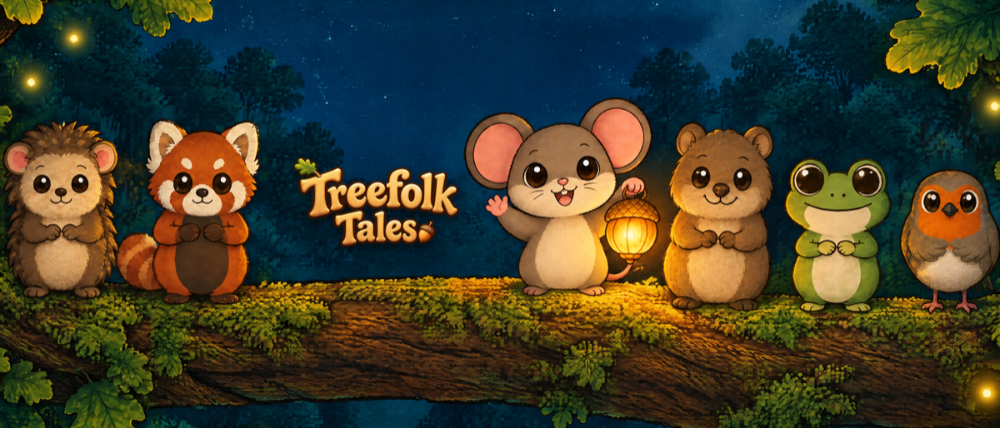
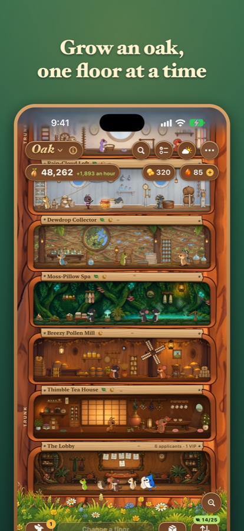
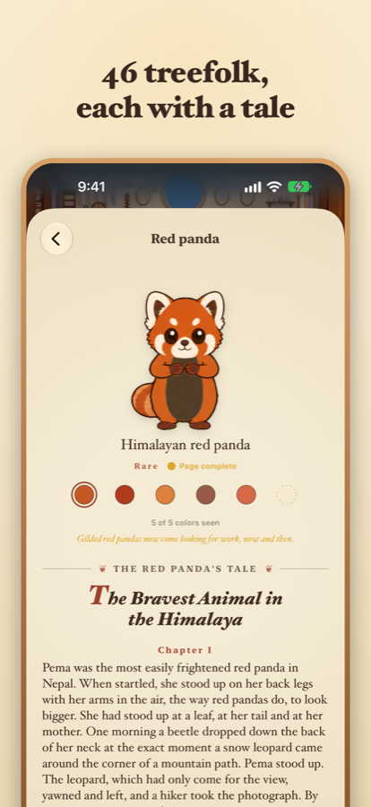
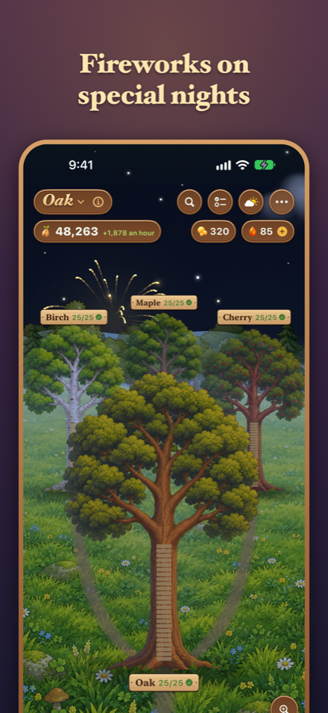

# Treefolk Tales — Press Kit

An idle builder about a tree full of small animals, and every one of them has a story.

## Downloads

| What | Link |
| --- | --- |
| Press kit (screenshots for iPhone and iPad, header art, search art, app icon, splash) | [Treefolk-Tales-Press-Kit.zip](https://github.com/treefolktales/Treefolk-Tales/releases/download/press-kit/Treefolk-Tales-Press-Kit.zip) (115 MB) |
| App preview, iPhone | [iphone-6.9-preview.mp4](https://github.com/treefolktales/Treefolk-Tales/releases/download/press-kit/iphone-6.9-preview.mp4) (36 MB) |
| App preview, iPad | [ipad-13-preview.mp4](https://github.com/treefolktales/Treefolk-Tales/releases/download/press-kit/ipad-13-preview.mp4) (36 MB) |

## Fact sheet

| | |
| --- | --- |
| Name | Treefolk Tales |
| Genre | Idle builder, storybook |
| Platforms | iPhone and iPad (iOS 26) |
| Release | Coming soon |
| Price | Free to play, no ads. Optional purchases; every floor can be earned by playing |
| Developer | One independent developer |
| Website | [treefolktales.com](https://treefolktales.com/) |
| Contact | support@treefolktales.com |

## About the game

You grow an oak one floor at a time: a bakery, a workshop, a spa, an observatory and dozens more. Then you hire treefolk to run them, 46 in all, from mice and hedgehogs to a red panda and a moon hare.

Each of the animals has their own tale in the Book of Treefolk, and no two are the same kind of story: a possum at his own funeral, a stoat paid to protect rabbits from himself, a tanuki chasing one job in four disguises. Chapters open as you meet them, hire them and offer them their dream job.

The tales share one mystery: who is the Gardener? Nobody has seen them, yet every night someone builds a new room, refills the shelves and posts a help-wanted card for exactly the job somebody dreamed of.

## Features

- 46 treefolk to hire, each with their own tale
- Four trees on the hill: oak, cherry, maple and birch
- Days, nights and seasons; the game opens in the player's real season, north or south
- Visitors on the perch, pets that wander between floors, and rooms to decorate
- Fireworks nights for New Year's Eve, Lunar New Year and Diwali
- Game Center achievements, leaderboards and save sync
- No ads, no accounts, no personal data collected

## Screenshots

  

Press may use these screenshots and art in coverage of Treefolk Tales.
